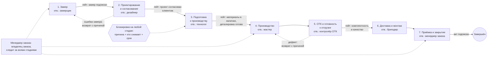

# «Контур заказов» — документ проектирования MVP

Версия 1.2 · 17.10.2026 · статус: готово к разработке после ревью ([04_coo_review.md](04_coo_review.md)) и аудита прослеживаемости ([05_traceability_audit.md](05_traceability_audit.md))

> Все цифры о компании взяты из вводных (120 сотрудников, ~900 млн ₽/год, «каждый третий заказ срывает сроки») и **не проверены**. Нормативы, пороги и данные в приложении — демонстрационные допущения, а не нормативы фабрики. **Ни одна гипотеза о причинах срывов не подтверждена**: фактических данных компании у проекта нет.

### Что изменилось в версии 1.1

| Было (1.0) | Стало (1.1) | Почему |
|---|---|---|
| Ценность — через видимость заказов | Первым идёт ретроспективная диагностика 60 закрытых заказов; инструмент дополняет организационные меры, а не заменяет их | Допущение «срывы — от потери информации» не проверено (ревью, §1) |
| 7 гипотез, проверка по данным MVP через 6–8 недель | 9 гипотез (H0–H8), включая «нереалистичный срок при продаже» и «нехватка денег на материалы»; проверка по ретроспективе с решающими правилами, зафиксированными заранее | Данные MVP появятся поздно и будут смещены самоотчётом |
| 18 функций | Ядро из 10 функций + 1 условная; остальное перенесено на этап 2 (§8.3) | Максимум управленческой ценности при минимуме разработки |
| Только программные критерии приёмки | Три уровня: продукт, внедрение, диагностика (§10) | Принятая программа не доказывает эффект |
| Нет организационных мер | ORG-01…ORG-06 — обязательная часть первого этапа (§5) | Дисциплину и ответственность программа не создаёт |

### Что изменилось в версии 1.2 (аудит прослеживаемости)

| Изменение | Почему |
|---|---|
| Причина отклонения — отдельная сущность «Отклонение» (несколько на заказ), а не поле заказа | Одно поле затирало прежние причины и теряло их у закрытых заказов; распределение смещалось к поздним стадиям |
| Новое поле «исполнитель следующего действия» | Главный вопрос продукта — «кто отвечает за следующий шаг», а система показывала ответственного за стадию |
| Регистрация с первого обязательства перед клиентом; сроки — с даты договора; первоначальный срок «подтверждён / не подтверждён» | Иначе метрика срывов искажается при переносе заказов из таблиц и до договора |
| Поздно закрытый заказ — только с причиной; метрика срывов — за период | Причины самых важных случаев не собирались; метрика не показывала изменений |
| Признак «действие запланировано после срока заказа»; «обновлён» — только по операционным полям | Ранний сигнал неизбежного срыва; защита от пустых правок |
| FR-20 Рекламация, FR-21 Еженедельный снимок показателей, FR-22 Исполнитель действия, FR-23 Договор | Для P3 не было ни решения, ни измерения; пилот было не с чем сравнить |
| Явно записано, какие проблемы v1 не решает или измеряет вне системы (§1.1) | Не выдавать незакрытые проблемы за закрытые |

---

## 1. Проблема бизнеса и ожидаемая ценность

**Управленческая проблема.** Руководство узнаёт о проблеме заказа, когда клиент или дилер уже жалуется. Что именно вызывает срывы — неизвестно.

| Заявлено собственником (не проверено) | Что это означало бы для управления |
|---|---|
| Заказы в 3 таблицах + CRM, заполняемой нерегулярно | Нет единой версии правды; нельзя посчитать ни один показатель |
| ~1/3 заказов срывает сроки | Срыв фиксируется постфактум; неизвестно, где он зародился и корректен ли сам срок |
| Дилеры звонят собственнику | Нет видимого снаружи владельца заказа и/или собственник сам остаётся точкой входа |
| Маржа видна только в месячном итоге | Нельзя отличить убыточный заказ от прибыльного |
| Совещания без показателей | Решения принимаются по самому громкому сигналу |
| Нет регламентов, обучение устное | Правила живут в головах |
| Растут рекламации | Переделки съедают деньги и мощность |
| 4 месяца низкого спроса, нужно сохранить деньги | Решение должно быть дешёвым; сезон сам изменит загрузку и сроки — это нужно учитывать при оценке эффекта |

**Ценность MVP** — каждое утро отвечать на вопрос: *какие заказы требуют вмешательства сегодня, почему и кто отвечает за следующий шаг*. Инструмент **не устраняет причины срывов**. Он поддерживает организационные решения (владелец заказа, еженедельный разбор, регламент) и копит данные о переходах стадий. Причины ищем ретроспективной диагностикой (§3); она идёт параллельно и инструмента не ждёт.

**Чего программа не может** (подробнее — ревью, §4): назначить владельца заказа с полномочиями; отучить дилеров звонить собственнику, если собственник продолжает отвечать; добиться честного указания причин, если за них наказывают. Это решения руководства.

Чего MVP **не** делает: не заменяет ERP/CRM, не планирует загрузку производства, не ведёт склад, не считает чистую прибыль.

### 1.1 Покрытие проблем в v1 (по итогам аудита)

| Проблема | Чем решается в v1 | Как измеряется результат |
|---|---|---|
| P1 Данные в 3 таблицах + CRM | Реестр (FR-01), ORG-05 | B7: параллельные таблицы не ведутся |
| P2 Срывы сроков | FR-02…FR-08, FR-18, FR-23 | Доля закрытых с нарушением подтверждённого первоначального срока за период (FR-18, BR-26); база — ретроспектива |
| P3 Рекламации | FR-20: рекламация как заказ со ссылкой на исходный и причиной | Число рекламаций за период и их стадии возникновения. **Стоимость в v1 не измеряется** |
| P4 Дилеры звонят собственнику | ORG-02, исполнитель следующего действия (FR-22), фильтр по каналу | **Вне системы:** журнал обращений к собственнику (ORG-02) |
| P5 Маржа заказа неизвестна | Только условная C-11 (план) | **Не решается в v1.** Фактическая маржа требует пообъектного учёта затрат — решение в учёте |
| P6 Совещания без показателей | FR-09, FR-14, FR-21, ORG-03 | B4 (протокол), динамика по снимкам FR-21 |
| P7 Нет регламентов | ORG-04 | Только факт наличия (B1); **эффект в пилоте не измеряется** |
| P8 Сохранить деньги | Низкая стоимость решения; C-11 как стоп-сигнал против скидок | **Денежный эффект инструментом не измеряется**; косвенно — число рекламаций |

## 2. AS-IS: текущий процесс и точки потери информации

Модель восстановлена по вводным и типовой практике мебельного производства на заказ. Она **должна быть подтверждена интервью** с менеджерами, замерщиком, технологом, мастером и двумя дилерами.

```
Клиент/дилер → [Менеджер шоурума/дилер] → [Замерщик] → [Дизайнер] ⇄ клиент → [Технолог/подготовка]
   → [Производство] → [ОТК?] → [Логистика/монтаж] → [Приёмка] → (рекламация?) → ...
```

| # | Передача | Точка потери (П) | Последствие |
|---|---|---|---|
| П0 | Продажа | Срок клиенту, возможно, обещается без учёта очереди *(v1.1)* | Срыв заложен до начала работ |
| П1 | Продажа → замер | Заказ живёт в таблице шоурума или дилера; фабрика о нём не знает до проекта | Дилер не знает, кому звонить |
| П2 | Замер → проект | Размеры передаются неформально | Ошибка замера всплывает на производстве или монтаже |
| П3 | Проект ⇄ клиент | Число итераций не фиксируется | Сроки «съедаются» до запуска, срок заказа не пересматривается |
| П4 | Проект → подготовка | Нет проверки материалов (и денег на них) до запуска | Заказ встаёт в производстве |
| П5 | Производство → монтаж | Нет гейта качества и комплектности | Дефекты на объекте → рекламации |
| П6 | Любая стадия | Нет владельца следующего шага | Заказ «висит» между отделами |
| П7 | Финансы | Факт затрат, возможно, не привязан к заказу | Перерасходы не видны до конца месяца |
| П8 | Управление | Нет показателей | Совещание обсуждает инциденты, а не систему |

Точки П0–П8 — гипотезы о том, где теряется информация, а не установленные факты.

## 3. Симптомы, гипотезы и проверка

### 3.1 Три слоя

| Слой | Содержание |
|---|---|
| Заявленные факты | См. §1. Подтверждены документами: **ни один** |
| Симптомы | Задержки; рост рекламаций; эскалации дилеров к собственнику; маржа заказа неизвестна; решения без данных |
| Гипотезы | H0–H8 ниже |
| Подтверждённые причины | **Нет.** Статус всех гипотез — «не проверена» |

### 3.2 Гипотезы

| ID | Гипотеза | Решающий признак | Что опровергнет | Статус |
|---|---|---|---|---|
| H0 | Срок обещается при продаже без учёта очереди и длительности | Обещанный срок короче медианы фактической длительности заказов без инцидентов | Срывы только у заказов с инцидентами | не проверена |
| H1 | Ошибки замера | Доля заказов с повторным замером или перераскроем; концентрация по замерщикам или дилерам | Возвраты редки или не связаны с замерщиком | не проверена |
| H2 | Повторные согласования проекта «съедают» срок до запуска | Медиана «замер → подпись проекта» у сорванных заказов заметно выше, чем у сданных в срок; более 2 версий проекта | Интервал одинаков у сорванных и сданных в срок | не проверена |
| H3 | Перегрузка производства или узкого участка | Доля сорванных выше в недели запуска с загрузкой выше медианы; растёт ожидание при стабильной обработке | Срывы не зависят от загрузки недели | не проверена |
| H4 | Нехватка материалов, в т.ч. из-за денег на закупку | Ожидание материалов на стадиях 3–4; отложенные оплаты поставщикам | Ожидание материалов — малая доля дней задержки | не проверена |
| H5 | Нет владельца следующего шага: заказ «висит» между отделами | Простои между стадиями без внешней причины | Простоев между стадиями нет | не проверена |
| H6 | Рекламации — следствие отсутствия контроля перед отгрузкой | Причины рекламаций по стадии **возникновения**: изделие и комплектация против монтажа | Рекламации в основном монтажные | не проверена |
| H7 | Маржа размывается переделками и скидками | Доля переделок за счёт фабрики и скидок в выручке | — | **не проверяема**, пока нет пообъектного учёта затрат |
| H8 | Дилерский канал устроен иначе и хуже управляется | Сравнение каналов по разложению задержек; кто замеряет у дилеров | Различий нет | не проверена |

### 3.3 Как проверяем

Основной способ — **ретроспектива, а не данные MVP**:
- 60 закрытых заказов за 3–6 месяцев;
- реконструкция дат по стадиям;
- эталон длительности — медиана заказов, сданных в срок;
- разложение дней задержки по стадии **возникновения**;
- сравнение сорванных заказов со сданными в срок.

Решающие правила фиксируются до анализа. Пороги — управленческая договорённость, а не статистика; на 60 заказах выводы ориентировочные. Методика, правила и перечень данных — в ревью, §3.

Данные MVP (журнал переходов, причины со стадией возникновения) дополняют ретроспективу через 6–8 недель: по ним видно, сохраняется ли картина после изменений.

## 4. TO-BE: целевой процесс (гипотеза)

Ключевые изменения:
- **один менеджер заказа отвечает за заказ целиком** и служит единой точкой контакта для клиента и дилера;
- у каждого шага есть **ответственный, следующее действие и срок**;
- переход стадии — это проверка условий, а не просто смена статуса.



**Неопределённость модели.** TO-BE — гипотеза, а не утверждённый процесс. Не подтверждено:
1. кто замеряет и проектирует в дилерском канале;
2. идут ли стадии строго последовательно (закупка материалов может начинаться во время проектирования);
3. когда фиксируется срок клиенту — до проекта или после;
4. есть ли гейт оплаты перед запуском в производство (в схеме его нет).

Поэтому в v1 система **учитывает** переходы, включая нелинейные, но **не запрещает** их. Возврат на предыдущую стадию требует причины и комментария, потому что это данные для H1 и H2.

Содержание гейтов (подписан ли замер, есть ли материалы) система не проверяет: она требует ответственного и следующий шаг, а содержание проверяет человек. Чек-листы гейтов — этап 2.

## 5. Роли, ответственность и организационные меры

| Роль | Зона ответственности | Что делает в «Контуре» |
|---|---|---|
| Собственник | Эскалации, цены, приоритеты; **сам переадресует дилеров координатору** | Смотрит список «Требуют вмешательства» |
| Операционный директор / рук. производства | Ведёт еженедельное совещание; загрузка; снятие блокировок | Подтверждает причины отклонений на совещании |
| Коммерческий директор | Шоурумы, дилеры, правила назначения сроков клиенту | Контролирует полноту данных менеджеров |
| Менеджер заказа (A — accountable) | Заказ от договора до закрытия; единое окно для клиента и дилера | Ведёт карточку, обновляет следующий шаг не реже раза в неделю |
| Координатор дилеров | Точка входа для дилеров | По фильтру «канал = дилер» отвечает без собственника |
| Замерщик, дизайнер, технолог, мастер, ОТК, бригадир (R) | Своя стадия | Указываются ответственными за стадию |

В MVP нет авторизации: «кто вносит изменение» выбирается вручную и **не проверяется** (см. §11).

**Организационные меры — обязательная часть первого этапа.** Без них инструмент не работает:

| ID | Мера | Владелец |
|---|---|---|
| ORG-01 | Приказ: менеджер заказа — владелец заказа на весь цикл, с правом требовать сроки от цеха, снабжения и монтажа | Собственник |
| ORG-02 | Собственник переадресует обращения дилеров координатору; обращения записываются | Собственник |
| ORG-03 | Еженедельное совещание 30 минут. Повестка — список «Требуют вмешательства»; по каждому заказу решение, ответственный, срок; причины отклонений подтверждаются здесь | Операционный директор |
| ORG-04 | Регламент на 1–2 страницы: владение заказом, назначение срока клиенту, блокировка и её снятие, обновление статуса не реже раза в неделю | Руководитель проекта |
| ORG-05 | С утверждённой даты три таблицы только для чтения; единственный источник — реестр | Собственник |
| ORG-06 | За названную причину отклонения не наказывают; разбирают процесс | Собственник |

## 6. Бизнес-правила

Обозначения: *сегодня* — дата расчёта; *активный* — заказ без даты закрытия. Пороги — в конфигурации, значения демонстрационные.

**Область действия в v1.2:**
- **ядро v1:** BR-01, BR-04…BR-06, BR-08, BR-09, BR-18…BR-28;
- **в v1 частично:**
  - BR-02, BR-03 — только по сроку заказа, контрольный срок стадии — этап 2;
  - BR-10 — в v1 только обязательные поля при переходе и возврат с причиной;
- **условно (C-11):** BR-11, BR-12, BR-14 в части низкой плановой маржи;
- **этап 2:** BR-07, BR-13, BR-14 в части перерасхода, BR-14a, BR-15.

Реализация 1.0 выполняет все правила версии 1.0.

| ID | Правило |
|---|---|
| BR-01 | Стадия (где заказ в процессе) и состояние управления (насколько он под контролем) — **разные поля**. Состояние не вводится руками, а вычисляется по правилам. Исключение — блокировка: это факт, который вносит человек. |
| BR-02 | **Просрочен**: у активного заказа **с договором** (BR-24) плановая дата завершения строго меньше сегодняшней даты. Срок «сегодня» — не просрочка. Сроки — в календарных днях, без учёта праздников. *(1.0 учитывала также контрольный срок стадии; в v1.1 — этап 2.)* |
| BR-03 | **Приближается срок**: до плановой даты завершения от 0 до N дней включительно (N = 3). |
| BR-04 | **Заблокирован**: установлен флаг блокировки. Блокировка допускается только с причиной из справочника, комментарием и следующим действием «кто и когда снимает». |
| BR-05 | **Под риском**: есть хотя бы один признак — приближается срок; нет менеджера, ответственного за стадию или исполнителя следующего действия; нет следующего действия или его срока; срок действия прошёл; действие запланировано после срока заказа (BR-25); статус не обновлялся более 7 дней. *(v1.2)* «Обновлён» = изменено хотя бы одно операционное поле: стадия, ответственные, исполнитель, следующее действие или его срок, блокировка, срок заказа, отклонение. Правка финансовых полей и комментариев статус не обновляет. |
| BR-06 | Признаки не взаимоисключающие. Главное состояние для бейджа выбирается по приоритету: Просрочен > Заблокирован > Под риском > В норме. Фильтр по состоянию ищет по **всем** состояниям заказа. |
| BR-07 | *(этап 2)* Финансовые признаки показываются отдельно и не меняют операционное состояние. |
| BR-08 | **Завершён**: заказ закрыт датой акта. Завершённые исключаются из операционных долей. Нарушение срока для них считается от **первоначального** срока (только если он подтверждён, BR-23) и за период (BR-26). |
| BR-09 | Первоначальный срок фиксируется при создании и не редактируется. Перенос планового срока требует причины и комментария и пишется в журнал. Перенос убирает просрочку, но заказ получает признак «срок перенесён на N дн.». |
| BR-10 | Переход стадии требует ответственного за стадию, следующего действия, его исполнителя и срока. Возврат на предыдущую стадию — с причиной и комментарием. *(Запрет пропуска стадий — этап 2, после подтверждения линейности процесса.)* |
| BR-11 | Плановый маржинальный доход = договорная выручка − плановая себестоимость; маржинальность = МД / выручка × 100 %. |
| BR-12 | Если выручка = 0, маржинальность «не определена». Если нет любого из слагаемых — «нет данных». Отсутствующий факт никогда не заменяется планом. |
| BR-13 | *(этап 2)* Статус достоверности финансов: нет данных → только план → факт предварительный → факт подтверждён. |
| BR-14 | Низкая маржинальность: плановая < порога **своего канала** (шоурум / дилер; 25 % — допущение для шоурума, порог дилера утверждает руководитель; *условно, C-11*). Агрегат — по договорам за период (BR-26); рекламации (BR-27) в маржинальные агрегаты не входят. *(QA D13)* Основной заказ с нулевой выручкой и ненулевой себестоимостью получает признак и входит в агрегат со своим отрицательным МД. Перерасход > 10 % — *этап 2*. |
| BR-14a | *(этап 2)* Нулевая выручка при ненулевых затратах → признак «затраты за счёт фабрики». |
| BR-15 | *(этап 2)* Агрегированная маржинальность — средневзвешенная, только по заказам с полными данными, с указанием «по N из M». |
| BR-16 | Маржинальный доход — **не** чистая прибыль. |
| BR-17 | Для дилерских заказов выручка — сумма, которую получает фабрика. Допущение, требует подтверждения. |
| BR-18 | *(v1.2)* Отклонение — **отдельная запись**: причина, стадия возникновения, стадия обнаружения (ставится системой = текущая стадия), дата, комментарий, статус. У заказа может быть несколько отклонений; новое не затирает прежние. Блокировка, перенос срока, возврат стадии и позднее закрытие ссылаются на отклонение. |
| BR-19 | *(v1.1)* У отклонения есть статус: «указано исполнителем» или «подтверждено на совещании». Распределение причин строится **по отклонениям за период, включая закрытые заказы**, в двух срезах (все / подтверждённые); выводы — только по подтверждённым. |
| BR-20 | *(v1.2)* Дату входа в текущую стадию ставит система при переходе. Длительность стадии = сумма всех посещений этой стадии по журналу; при возврате прежние посещения сохраняются. |
| BR-21 | *(v1.2)* У следующего действия есть **исполнитель** — обязательное поле, по умолчанию ответственный за стадию. *(QA D14)* Подстановка — только когда действие задаётся в этом же сохранении; правка других полей исполнителя не назначает. Для блокировки исполнитель — тот, кто её снимает. Список вмешательства показывает исполнителя действия. |
| BR-22 | *(v1.2)* Закрыть заказ позже первоначального срока можно только с отклонением: причина и стадия возникновения. *Уточнено при реализации:* правило действует и для несверенного срока, потому что объяснение причины нужно в любом случае; из метрики FR-18 такой заказ всё равно исключается (BR-23). |
| BR-23 | *(v1.2)* Первоначальный срок = срок из договора. Для заказов, перенесённых из таблиц, он помечается «подтверждён», только если сверен с договором. Иначе — «не подтверждён», и заказ исключается из метрики FR-18; число исключённых показывается рядом с метрикой. |
| BR-24 | *(QA D12: сроки не раньше даты договора; QA D11: дата закрытия не раньше даты договора и входа в стадию 7)* Заказ регистрируется с первого обязательства перед клиентом (оплаченный замер или проект) — до договора, чтобы замер и проектирование попали в данные. Дата договора, плановый и первоначальный сроки обязательны с момента подписания договора. До договора просрочка по сроку заказа не считается; правила владельца, исполнителя и следующего шага действуют. |
| BR-25 | *(v1.2)* Если срок следующего действия позже планового срока заказа, а сам срок ещё не нарушен — признак риска «действие запланировано после срока заказа». *Уточнено при реализации:* у просроченного заказа любое будущее действие формально «после срока», и признак превращался в шум. |
| BR-26 | *(v1.2)* Метрики с датой события (закрыто с нарушением срока, рекламации, отклонения, договоры для C-11) считаются за период: по умолчанию последние 28 дней и весь пилот. Знаменатель и границы периода указываются. |
| BR-27 | *(v1.2)* Тип заказа: «основной» или «рекламация». Рекламация ссылается на исходный заказ и при создании требует отклонения с причиной и стадией возникновения в исходном заказе. |
| BR-28 | *(v1.2)* Еженедельный снимок: дата и значения показателей панели с числителями и знаменателями. Снимок неизменяем; сравнение — с предыдущим снимком и с неделей 1 пилота. |

## 7. Модель данных

*(v1.2)* Сущности: «Заказ», «Отклонение» (несколько на заказ), журнал событий, еженедельный снимок показателей. Справочники и пороги — в конфигурации.

| Поле | Тип | Обяз. | v1.1 | Комментарий |
|---|---|---|---|---|
| id | строка | да | ядро | уникальный |
| client | строка | да | ядро | клиент или дилер |
| channel | `showroom` / `dealer` | да | ядро | |
| sales_point | строка | да | ядро | шоурум или город дилера |
| manager | строка | нет* | ядро | менеджер заказа |
| stage | 1..7 | да | ядро | |
| stage_entered_at | дата | да | **новое** | ставится системой (BR-20) |
| created_at | дата | да | ядро | *(v1.2)* дата первого обязательства перед клиентом (BR-24) |
| order_type | `main` / `complaint` | да | **новое v1.2** | рекламация (BR-27) |
| parent_order_id | строка | для рекламации | **новое v1.2** | исходный заказ |
| contract_date | дата | с договора | **новое v1.2** | дата договора (BR-24) |
| baseline_completion | дата | с договора | ядро | первоначальный срок, не редактируется |
| baseline_verified | bool | с договора | **новое v1.2** | сверен с договором (BR-23) |
| planned_completion | дата | с договора | ядро | текущий плановый срок |
| stage_owner | строка | нет* | ядро | ответственный за стадию |
| updated_at | дата | да | ядро | ставится системой |
| is_blocked | bool | да | ядро | |
| block_deviation_id | ссылка | при блокировке | **новое v1.2** | отклонение, вызвавшее блокировку (заменяет `risk_reason` / `risk_comment` 1.0) |
| next_action | текст | нет* | ядро | |
| next_action_owner | строка | нет* | **новое v1.2** | исполнитель следующего действия (BR-21) |
| next_action_due | дата | нет* | ядро | |
| status_updated_at | дата | да | **новое v1.2** | последнее изменение операционных полей (BR-05); заменяет `updated_at` в правиле «давно не обновлялся» |
| closed_at | дата | нет | ядро | заполнено ⇔ заказ завершён |
| contract_price, planned_cost | ₽ ≥ 0 | нет | условно (C-11) | |
| milestone_date | дата | — | этап 2 | контрольный срок стадии |
| actual_revenue, actual_cost, actual_cost_confirmed | — | — | этап 2 | фактические финансы |

\* Пустое значение порождает признак риска; при смене стадии поле обязательно.

**Отклонение** *(v1.2, BR-18, BR-19)*:

| Поле | Тип | Обяз. | Комментарий |
|---|---|---|---|
| id | строка | да | |
| order_id | ссылка | да | |
| reason | код справочника | да | |
| origin_stage | 1..7 | да | стадия возникновения |
| detected_stage | 1..7 | да | стадия обнаружения; ставится системой |
| detected_at | дата | да | ставится системой |
| comment | текст | да | что произошло |
| confirmed | bool | да | подтверждено на совещании |
| confirmed_at | дата | при подтверждении | |
| trigger | `block` / `deadline_move` / `stage_back` / `late_close` / `complaint` / `manual` | да | каким событием создано |

**Журнал v1:** `{ts, order_id, user, field, old, new, comment}` — только для стадии, сроков, блокировки, ответственных, исполнителя, следующего действия и отклонений.

**Снимок показателей** *(v1.2, BR-28)*: `{date, user, metrics: {key: {numerator, denominator, value}}}`.

**Справочник причин** (предварительный, для проверки гипотез): ошибка замера, повторное согласование проекта, изменение клиентом требований, нехватка материалов, перегрузка производства, ошибка комплектации, перенос монтажа, дефект изделия, проблема логистики, прочее. **Добавлено в v1.1:** нереалистичный срок при продаже, ожидание оплаты клиентом, ошибка проектирования / деталировки, неготовность объекта клиента. *(v1.2)* Последняя переименована в «неготовность объекта / клиент не принимает работу»: дата акта зависит от клиента, и такие срывы при анализе нужно отделять (аудит, Л-Ср6). Без них справочник подталкивает к выводу «виновато исполнение».

## 8. Требования

### 8.0 Объём v1.2

| Ядро v1 | Требования 1.0 | Состав в v1.1 |
|---|---|---|
| C-01 Реестр активных заказов | FR-01 | Поля §7 с отметкой «ядро» / «новое» |
| C-02 Вычисляемое состояние | FR-02, FR-05 | Признаки: срок заказа нарушен или близко; заблокирован; нет менеджера, ответственного или исполнителя; нет следующего действия или срока; действие просрочено; действие после срока заказа; не обновлялся > 7 дн.; срок перенесён |
| C-03 «Требуют вмешательства» | FR-14 | Главный экран и повестка совещания; показывает **исполнителя** следующего действия; внутри группы — по сроку (для просроченных — по дням просрочки) |
| C-04 Смена стадии | FR-03, часть FR-04, FR-19 | Обязательны ответственный, действие, исполнитель и срок; возврат — с отклонением; пропуск фиксируется, но не запрещён; длительность стадии — сумма посещений |
| C-05 Первоначальный срок | FR-08, FR-23 | Срок с даты договора; отметка «подтверждён»; перенос — с отклонением |
| C-06 Блокировка | FR-07 | Через отклонение; исполнитель действия = кто снимает |
| C-07 Отклонения | FR-06 | Сущность «Отклонение»: расширенный справочник, стадии возникновения и обнаружения, подтверждение на совещании |
| C-08 Журнал ключевых событий | часть FR-13 | Стадия, сроки, блокировка, ответственные, исполнитель, действие, отклонения |
| C-09 Панель | FR-09, часть FR-10 | Активные; просрочено; под риском; заблокировано; без владельца / исполнителя / шага (с разбивкой); не обновлялся > 7 дн.; заказы по стадиям; отклонения за период по стадии возникновения (все / подтверждённые, доля подтверждённых); рекламации за период. Фильтры: ответственный (включая исполнителя), канал. Таблицы вместо графиков |
| C-10 Закрытие | FR-18 | Дата акта; позднее закрытие — только с отклонением; доля закрытых с нарушением подтверждённого первоначального срока за период |
| C-11 *(условно)* Плановая маржа | часть FR-11, часть FR-12 | Только если расчёт цены даёт плановую себестоимость; порог по каналу; агрегат по договорам за период без рекламаций |
| C-12 *(v1.2)* Рекламации | FR-20 | Заказ типа «рекламация» со ссылкой на исходный заказ и отклонением |
| C-13 *(v1.2)* Еженедельный снимок | FR-21 | Кнопка «Зафиксировать неделю»; сравнение с прошлой неделей и неделей 1 |

FR-16 (демо-данные, сброс) — функция демонстрации, а не продукта.

### 8.1 Функциональные требования ядра

| ID | Проблема бизнеса | Требуемое поведение | Критерий приёмки | Проверка |
|---|---|---|---|---|
| FR-01 | Нет единой версии данных | Единый реестр активных заказов | Все заказы видны; карточка показывает ID, клиента, стадию, состояние, следующее действие, ответственного | AppTest, ручной сценарий |
| FR-02 | Статус не показывает управляемость | Состояние вычисляется отдельно от стадии | Заказ в «Производстве» может быть одновременно просрочен и заблокирован | Автотест |
| FR-03 | Заказы висят без владельца | При смене стадии обязательны ответственный, действие, исполнитель и срок | Переход без любого из полей отклоняется с понятной ошибкой | Автотест |
| FR-04 | Возвраты стадий не видны | Возврат требует отклонения; любой переход пишется в журнал с датой | Возврат без отклонения отклоняется; пропуск стадии сохраняется и виден в журнале | Автотест |
| FR-05 | Отклонения обнаруживаются постфактум | Автоматические признаки C-02 | Граничные даты по BR-02, BR-03, BR-05; признак BR-25 при сроке действия = сроку заказа + 1 день, при равенстве признака нет; правка только финансового поля не сбрасывает «давно не обновлялся» | Автотест |
| FR-06 | Причины не классифицированы и смещены | Сущность «Отклонение» (BR-18, BR-19) | Второе отклонение не затирает первое; распределение за период включает закрытые заказы; срезы «все» и «подтверждённые» с указанными знаменателями | Автотест |
| FR-07 | Блокировки «тихие» | Блокировка только через отклонение, с действием, исполнителем и сроком | Блокировка без отклонения или без исполнителя отклоняется | Автотест |
| FR-08 | Просрочка скрывается переносом срока | Первоначальный срок неизменен; перенос — с отклонением | Перенос без отклонения отклоняется; после переноса есть признак | Автотест |
| FR-09 | Совещания без показателей | Показатели C-09 со знаменателем и правилом | Доли — только по активным заказам с договором; «не обновлялся» и «без владельца / исполнителя / шага» выводятся с разбивкой; закрытые — отдельно, за период | Автотест, AppTest |
| FR-10 | Нет фокуса | Фильтры по ответственному (менеджер, ответственный за стадию, исполнитель) и каналу | Фильтр «дилер» пересчитывает показатели | Автотест, AppTest |
| FR-13 | Нет истории решений | Журнал ключевых событий со старым и новым значением | Каждое ключевое изменение — запись журнала | Автотест |
| FR-14 | Нет ответа «что делать сегодня» | Список «Требуют вмешательства»: группы по главному состоянию; внутри — просроченные по дням просрочки, остальные по ближайшему сроку заказа | Просроченные выше заблокированных, те выше «под риском»; внутри группы порядок по сроку; число признаков на порядок не влияет | Автотест |
| FR-18 | «Каждый третий» не измеряется | Закрытие; доля закрытых с нарушением подтверждённого первоначального срока за период (BR-22, 23, 26) | Закрытый позже первоначального срока — нарушение даже после переноса; позднее закрытие без отклонения отклоняется; заказ с неподтверждённым сроком исключён и учтён в счётчике исключённых; заказ, закрытый вне периода, не входит в знаменатель | Автотест |
| FR-19 | *(v1.1)* Длительность стадий неизвестна | Дата входа в стадию фиксируется автоматически; длительность — сумма посещений | Сценарий 3 → 4 → 3 → 4: длительность стадии 4 = сумма двух посещений | Автотест |
| FR-20 | *(v1.2)* Рекламации не учитываются (P3) | Заказ типа «рекламация» со ссылкой на исходный заказ и отклонением (BR-27) | Рекламацию нельзя создать без исходного заказа и отклонения; на панели — число рекламаций за период и стадии их возникновения; рекламации не входят в маржинальные агрегаты | Автотест |
| FR-21 | *(v1.2)* Пилот не с чем сравнить (P6) | Еженедельный неизменяемый снимок показателей (BR-28) | Снимок сохраняет числители и знаменатели; после изменения заказов старый снимок не меняется; видно сравнение с прошлой неделей | Автотест |
| FR-22 | *(v1.2)* Неясно, кто выполняет следующий шаг (P4) | Исполнитель следующего действия (BR-21) | Список вмешательства показывает исполнителя; фильтр «ответственный» находит заказ по исполнителю; без исполнителя — признак риска | Автотест, AppTest |
| FR-23 | *(v1.2)* Заказ до договора не имеет срока (P2) | Регистрация с первого обязательства; сроки — с даты договора (BR-24) | Заказ без договора не считается просроченным и не входит в знаменатель доли просрочек; ввод даты договора без срока отклоняется | Автотест |

### 8.2 Нефункциональные

| ID | Требование |
|---|---|
| NFR-01 | Локальный запуск одной командой; Python + Streamlit; без платных API и внешних сервисов |
| NFR-02 | Интерфейс на русском; работает на экране ноутбука. Мобильный экран — не требование v1 (сценарий не подтверждён) |
| NFR-03 | Бизнес-логика отделена от интерфейса (`kontur/domain.py`) и покрыта автотестами |
| NFR-04 | Хранение — локальный JSON-файл с атомарной записью; однопользовательский режим (ограничение явно указано). *(QA D15)* Форма отклоняет сохранение, если заказ изменён после её открытия |
| NFR-05 | Демонстрация основных сценариев ≤ 5 минут |
| NFR-06 | Нет реальных персональных данных; все имена и суммы синтетические |

### 8.3 Исключённые из v1 функции

| Функция (требование 1.0) | Почему не нужна в первой версии |
|---|---|
| Фактическая себестоимость, факт. маржа, перерасход, статус достоверности (FR-11 в части факта, FR-12) | Не подтверждено, что затраты списываются на заказ. Ручной ввод даст ложную точность; источником должен быть учёт |
| Контрольный срок стадии | Нормативов нет, придуманные даты дадут ложные тревоги. Вернётся из эталонных длительностей ретроспективы |
| Запрет пропуска стадий, запрет правки закрытых (часть FR-04) | Процесс может быть нелинейным; запрет заставит вносить фиктивные переходы |
| Экран настройки порогов (FR-15) | Пороги меняются редко и по решению руководства; экран провоцирует подгонять пороги под «зелёную» картину |
| Фильтры по стадии и состоянию (часть FR-10) | Главный экран уже группирует по состоянию; решений эти фильтры не меняют |
| Графики | Таблица чисел достаточна для совещания; графики понадобятся вместе с динамикой |
| Выгрузка CSV (FR-17) | Возвращает в Excel и создаёт параллельную версию правды |
| Пополевой и финансовый журнал (часть FR-13) | Для управления нужны события процесса; без авторизации журнал всё равно не доказателен |
| Мобильная адаптация как требование | Сценарий не подтверждён |
| Финансовые признаки, кроме C-11 | Без факта затрат остаётся только «нет данных» |

### 8.4 Расхождение с реализацией 1.0 (план разработки v1.2)

**Статус на 17.10.2026: работы 1–7 выполнены** (реализация v1.2, см. [02_test_report.md](02_test_report.md)). Исходный объём работ:

| # | Работа | Требования |
|---|---|---|
| 1 | Сущность «Отклонение» вместо полей `risk_reason` / `risk_comment`; миграция демо-данных | FR-04, 06, 07, 08, 18, 20 |
| 2 | Поля `next_action_owner`, `contract_date`, `baseline_verified`, `order_type`, `parent_order_id`, `stage_entered_at`, `status_updated_at` | FR-03, 19, 20, 22, 23 |
| 3 | Новые правила BR-21…BR-28 в `domain.py`; правки BR-02, 05, 08, 14 | FR-05, 18, 23 |
| 4 | Панель: новые показатели и периоды; снимок недели | FR-09, 21 |
| 5 | Скрыть исключённые функции (§8.3): логика и тесты остаются для этапа 2 | §8.3 |
| 6 | Демо-данные: заказ до договора; заказ с неподтверждённым первоначальным сроком; рекламация со ссылкой на исходный заказ; заказ, где исполнитель действия ≠ ответственный за стадию; заказ с несколькими отклонениями; заказ с возвратом стадии (повторное посещение) | §6 аудита |
| 7 | Тесты. Устаревают: `test_milestone_overdue_alone_makes_overdue`, параметры `test_warning_window_inclusive`, `test_stage_change_requires_owner_milestone_next` (контрольный срок), `test_reason_distribution` (модель причин), `test_threshold_setting_changes_flags` (экран настроек). Они переписываются или переносятся в набор этапа 2 | A1–A14 |

## 9. Ключевые сценарии использования

| ID | Актор | Сценарий |
|---|---|---|
| UC-1 | Собственник | Утром открывает «Требуют вмешательства»: по каждому заказу видит причину, ответственного и следующий шаг |
| UC-2 | Участники совещания | Проходят список; по каждому заказу фиксируют решение и подтверждают причину и стадию её возникновения |
| UC-3 | Менеджер заказа | Переводит заказ на следующую стадию; система требует ответственного, следующее действие и срок |
| UC-4 | Рук. производства | Блокирует заказ из-за нехватки материалов с причиной и сроком снятия; позже снимает блокировку |
| UC-5 | Координатор дилеров | По звонку дилера находит заказ и видит, кто отвечает и что будет дальше, без собственника |
| UC-6 | *(этап 2)* Экономист | Вносит фактическую себестоимость; видит перерасход и фактическую маржу |
| UC-7 | *(v1.2)* Менеджер сервиса | Регистрирует рекламацию со ссылкой на исходный заказ, причиной и стадией возникновения |
| UC-8 | *(v1.2)* Ведущий совещания | В конце совещания фиксирует снимок недели и сравнивает с прошлой неделей |

## 10. Критерии приёмки (v1.2)

Приёмка трёхуровневая. **Принятый продукт не означает доказанного эффекта, а проведённая диагностика не означает подтверждённой гипотезы.** Уровень А проверяется на синтетических данных и подтверждает только корректность расчётов (что можно и чего нельзя оценить на синтетике — аудит, §6).

### 10.1 Уровень А — продукт (синтетические данные)

| # | Критерий | Требования | Проверка | Статус после реализации v1.2 (17.10.2026) |
|---|---|---|---|---|
| A1 | Состояние и признаки по BR-02, 03, 05, 25 на граничных датах; заказ до договора не просрочен и не входит в знаменатель | FR-02, 05, 23 | Автотест | Выполнено: `TestDeadlines`, `TestOwnership`, `TestKpi::test_shares_and_denominators` |
| A2 | Переход стадии требует ответственного, действия, исполнителя и срока; возврат требует отклонения; пропуск фиксируется | FR-03, 04 | Автотест | Выполнено: `TestChanges::test_stage_change_requires_owner_executor_action`, `test_skip_forward_allowed_and_recorded`, `test_back_requires_deviation` |
| A3 | Отклонения: несколько на заказ, второе не затирает первое; стадии возникновения и обнаружения; статус подтверждения | FR-06 | Автотест | Выполнено: `TestChanges::test_second_deviation_does_not_overwrite_first`, `test_deviation_origin_cannot_be_after_detection` |
| A4 | Распределение отклонений за период включает закрытые заказы; срезы «все» и «подтверждённые» со знаменателями | FR-06, 09 | Автотест | Выполнено: `TestKpi::test_deviations_in_period_include_closed` |
| A5 | Блокировка, перенос срока, позднее закрытие и рекламация невозможны без отклонения | FR-07, 08, 18, 20 | Автотест | Выполнено: `TestChanges::test_block_*`, `test_deadline_move_*`, `test_late_close_*`, `TestComplaints::test_requires_*` |
| A6 | Метрика «закрыто с нарушением»: от подтверждённого первоначального срока, за период, со счётчиком исключённых | FR-18 | Автотест | Выполнено: `TestKpi::test_closed_late_period_and_exclusions` |
| A7 | Длительность стадии — сумма посещений (сценарий 3 → 4 → 3 → 4) | FR-19 | Автотест | Выполнено: `TestChanges::test_stage_revisit_durations_sum` |
| A8 | Исполнитель следующего действия показан в списке вмешательства и находится фильтром «ответственный» | FR-14, 22, 10 | Автотест, AppTest | Выполнено: `test_app::test_attention_list_shows_executor_and_order`, `test_filter_by_executor_and_channel` |
| A9 | Правка только финансового поля не сбрасывает признак «давно не обновлялся» | FR-05 | Автотест | Выполнено: `TestChanges::test_finance_edit_does_not_refresh_status`, `test_app::test_finance_edit_does_not_refresh_status` |
| A10 | Панель выводит показатели для B2, B3, B5 с числителем и знаменателем; ни один показатель без правила; маржинальный доход не называется прибылью | FR-09 | AppTest, ручная проверка | Выполнено: `test_app::test_dashboard_values_and_denominators` + ручная проверка в Chrome |
| A11 | Снимок недели неизменяем после изменения заказов; сравнение с прошлой неделей | FR-21 | Автотест | Выполнено: `test_app::test_snapshot_is_immutable`, `TestKpi::test_snapshot_is_a_copy` |
| A12 | Рекламация требует исходный заказ; на панели — число рекламаций за период; рекламации вне маржинальных агрегатов | FR-20 | Автотест | Выполнено: `TestComplaints::*`, `test_app::test_complaint_creation`, `TestKpi::test_complaints_and_margin_by_channel` |
| A13 | Исключённые функции (§8.3) не отображаются | §8.3 | Ручная проверка | Выполнено: `test_app::test_excluded_features_not_shown` + ручная проверка |
| A14 | Нет нерабочих элементов; синтетические данные помечены; демо-набор покрывает сценарии из §8.4 п. 6 | FR-16 | Ручная проверка, автотест | Выполнено: `test_data_storage::test_required_scenarios`, ручная проверка в Chrome |

### 10.2 Уровень Б — внедрение (после 4 недель пилота на реальных заказах)

Пороги — предложение; утверждает руководитель.

| # | Критерий | Порог | Чем измеряется |
|---|---|---|---|
| B1 | ORG-01…ORG-06 введены приказом или регламентом | да / нет | Документы |
| B2 | Доля активных заказов с менеджером, ответственным, исполнителем, следующим действием и сроком | ≥ 95 % | Панель (FR-09), снимки (FR-21) |
| B3 | Доля активных заказов со статусом, обновлённым за 7 дней (BR-05) | ≥ 90 % | Панель (FR-09), снимки (FR-21) |
| B4 | Совещание прошло по списку вмешательства, снимок зафиксирован | 4 из 4 недель | Протокол + снимки (FR-21) |
| B5 | Доля просроченных, заблокированных и закрытых поздно за период заказов, у которых **последнее** отклонение подтверждено на совещании | ≥ 90 % | Панель (FR-06) |
| B6 | Выборочная сверка 10 записей в неделю с реальностью | расхождений ≤ 2 из 10 | Вне системы: лист сверки |
| B7 | Параллельные таблицы не ведутся | да / нет | Вне системы |
| B8 | Доля активных заказов с подтверждённым первоначальным сроком (BR-23) | ≥ 80 % | Панель |
| B9 | Обращения дилеров к собственнику записываются | да / нет | Вне системы: журнал ORG-02 |

Если B1 не выполнен, пилот считается **не начатым**, независимо от уровня А. Если B8 не выполнен, метрика срывов FR-18 непредставительна, и это указывается рядом с ней.

### 10.3 Уровень В — диагностика

| # | Критерий |
|---|---|
| V1 | Решающие правила и пороги (ревью, §3.3) утверждены **до** анализа |
| V2 | Реконструированы даты по стадиям не менее чем для 60 закрытых заказов; для сорванных — полностью |
| V3 | Для каждой гипотезы H0–H8 указан статус («не проверена», «подтверждена на выборке», «опровергнута на выборке», «не проверяема») с цифрами и ограничениями выборки |
| V4 | Выбрано не более двух направлений изменения процесса — по наибольшей доле дней задержки |

**Текущий статус уровня В:** не начат. Все гипотезы — «не проверена», H7 — «не проверяема».

### 10.4 Прослеживаемость (ядро v1.2)

Полные цепочки «проблема → симптом → гипотеза → правило → функция → критерий → тест» и найденные разрывы — в [05_traceability_audit.md](05_traceability_audit.md), §2. Ниже — итоговое состояние после изменений 1.2. *Статус после реализации v1.2:* все тесты с пометками «новый» и «переписать» реализованы (имена — в §10.1, полный список — [02_test_report.md](02_test_report.md)). Исходные пометки: классы `TestOverdue`, `TestRiskFlags`, `TestKpi`, `TestTransitions` в [tests/test_domain.py](../tests/test_domain.py) и [tests/test_app.py](../tests/test_app.py).

| Требование | Проблема → симптом | Гипотеза | Правило | Функция | Критерий | Тест |
|---|---|---|---|---|---|---|
| FR-01 Реестр | P1 → S7 | — (enabler) | BR-01 | Реестр, карточка | A14, B7 | `test_registry_shows_all` |
| FR-02 Состояние | P2, P6 → S1, S6 | H5 | BR-01, 02, 06 | `evaluate()` | A1 | `test_blocked_and_overdue_in_production` |
| FR-03 Переход стадии | P2, P4 → S2, S4 | H5 | BR-10, 21 | `apply_changes()` | A2, B2 | `test_stage_change_requires_owner_milestone_next` → **переписать** (исполнитель вместо контрольного срока) |
| FR-04 Возврат | P2, P3 → S1, S3 | H1, H2, H6 | BR-10, 18 | Переход + отклонение | A2, A5 | `test_back_requires_reason_and_comment` → **переписать** под отклонение |
| FR-05 Признаки | P2 → S1, S2 | H5 | BR-02, 03, 05, 25 | `evaluate()` | A1, A9 | `TestOverdue::*`, `TestRiskFlags::*` + **новый** (BR-25, финансовая правка) |
| FR-06 Отклонения | P2, P3 → S1, S3 | H0–H6 | BR-18, 19 | Сущность «Отклонение», агрегат за период | A3, A4, B5 | **новый** |
| FR-07 Блокировка | P2 → S2 | H4 | BR-04, 18, 21 | `apply_changes()` | A5 | `test_block_requires_reason_comment_action` → **переписать** |
| FR-08 Первоначальный срок | P2 → S1 | H0 | BR-09, 23 | `baseline_completion`, `baseline_verified` | A5, B8 | `test_deadline_move_requires_reason_and_comment` → **переписать** |
| FR-09 Панель | P6 → S6 | — (enabler, измерение B2, B3, B5) | BR-06, 26 | `compute_kpi()` | A10 | `test_shares_use_active_denominator` + **новый** |
| FR-10 Фильтры | P4 → S4 | H8 (частично) | — | `filter_orders()` | A8 | `test_filters`, `test_filter_channel_recalculates_kpi` |
| FR-13 Журнал | P2 → S1 | H1, H2, H5 | BR-05, 20 | Журнал событий | A2 | `test_forward_one_stage_ok_and_audited` |
| FR-14 Список вмешательства | P6, P4 → S6 | H5 | BR-06, 21 | `attention_list()` | A8, B4 | `test_attention_order` → **переписать** (сортировка по сроку) |
| FR-18 Метрика срывов | P2 → S1 | все (результат) | BR-08, 22, 23, 26 | `compute_kpi()` | A6, B8 | `test_closed_late_vs_baseline_even_after_deadline_move` + **новый** (период, исключения) |
| FR-19 Длительность стадий | P2 → S1 | H1–H5 | BR-20 | `stage_entered_at`, журнал | A7 | **новый** |
| FR-20 Рекламации | P3 → S3 | H6, H1 | BR-27 | Тип заказа, ссылка | A12 | **новый** |
| FR-21 Снимок недели | P6 → S6 | — (измерение эффекта) | BR-28 | Снимок | A11, B4 | **новый** |
| FR-22 Исполнитель | P4 → S4, S2 | H5 | BR-21 | Поле, список, фильтр | A8, B2 | **новый** |
| FR-23 Договор | P2 → S1 | H0 | BR-24 | `contract_date` | A1 | **новый** |
| C-11 Плановая маржа *(условно)* | P5, P8 → S5 | H7 (частично) | BR-11, 12, 14 | `finance()` | A10 | `test_plan_margin` + **новый** (порог по каналу) |

Демонстрационные функции FR-16 и NFR-05 к проблемам бизнеса не относятся и в продуктовую приёмку не входят (кроме A14).

## 11. Риски и ограничения

| Риск / ограничение | Влияние | Митигация |
|---|---|---|
| Причина срывов вне процесса заказа: мощность, деньги на материалы, правила продаж | Инструмент не даст эффекта, но создаст ощущение контроля | Ретроспектива до масштабирования (§3); гипотезы H0, H3, H4 |
| Причины указывает тот, кто может быть их виновником | Смещённая статистика → неверный приоритет | Стадия возникновения, подтверждение на совещании (BR-18, BR-19), ORG-06 |
| Инструмент подменяет управленческие решения | Видимость без изменений; формальное заполнение полей | Уровень приёмки Б; выборочная сверка (B6) |
| Низкий сезон улучшит сроки сам по себе | Эффект ошибочно припишут инструменту | Сравнивать с учётом загрузки; база — ретроспектива доинструментального периода |
| Данные вносятся людьми | «Мусор на входе» | Признак «давно не обновлялся»; совещание; ORG-01, ORG-04 |
| Нет авторизации | Журнал не доказателен | Этап 2: вход по ролям |
| JSON-файл, однопользовательский режим | При одновременной работе сохраняется последняя запись | Этап 2: многопользовательское хранение или перенос правил в CRM |
| Пороги — допущения | Ложные срабатывания | Калибровка по ретроспективе |
| Риск «ещё одной таблицы» | Инструмент забросят | ORG-05: таблицы только для чтения |
| Импорт не реализован | Перенос активных заказов вручную | Этап 2 с проверкой полей, типов, дат, дубликатов ID, сумм |

## 12. План внедрения и оценки эффекта

Внедрение не требует денег, кроме времени людей. Низкий сезон даёт окно по нагрузке, но искажает оценку эффекта.

| Неделя | Действие | Результат |
|---|---|---|
| 0 | Решения собственника по ORG-01, ORG-02, ORG-06; запрос данных (ниже и ревью, §3.2); утверждение решающих правил (V1) | Можно начинать пилот |
| 1–2 | **Ретроспектива 60 закрытых заказов** (аналитик + технолог); визиты в цех и на замер. Параллельно — регламент (ORG-04) и перенос активных заказов в реестр | Разложение задержек, статусы гипотез |
| 3–6 | Пилот: все активные заказы, еженедельное совещание (ORG-03), таблицы заморожены (ORG-05) | Критерии B1–B7 |
| 6–7 | Решение по 1–2 направлениям изменения процесса (V4) | План изменений |
| 8–12 | Изменения процесса; данные MVP показывают, есть ли сдвиг | Оценка эффекта |

**Метрики эффекта** (база — ретроспектива): доля закрытых с нарушением первоначального срока; дни задержки по стадиям возникновения; доля активных заказов без владельца или следующего шага; доля не обновлявшихся более 7 дней; число рекламаций; число прямых обращений дилеров к собственнику.

### Данные, которые нужно запросить до реального внедрения

1. Выгрузка трёх таблиц и CRM: активные заказы и закрытые за 6–12 месяцев, с плановыми и фактическими датами по стадиям.
2. Фактическая оргструктура: кто реально замеряет, проектирует, принимает решение о запуске.
3. Нормативные или фактические средние длительности стадий, если есть.
4. Как считается себестоимость: списываются ли материалы и работы на заказ, кто и с какой задержкой.
5. Журнал рекламаций: заказ, причина, стадия возникновения, стоимость устранения.
6. Условия работы с дилерами: цена для дилера, скидки, кто платит за переделки.
7. Приемлемый порог маржинальности и правила скидок.
8. Как измерено «каждый третий заказ» и что считается срывом: относительно договора или внутреннего плана, с какого числа дней.
9. Кто замеряет и проектирует в дилерском канале.
10. Когда и кем фиксируется срок клиенту; пересчитывается ли он после согласования проекта.
11. Загрузка производства по неделям, мощность узкого участка, сверхурочные.
12. Задержки поставок и оплат поставщикам за 6 месяцев.
13. Даёт ли программа расчёта цены плановую себестоимость (от этого зависит C-11).
14. *(v1.2)* Даты и сроки из договоров по активным заказам — чтобы подтвердить первоначальные сроки при переносе (BR-23).
15. *(v1.2)* Регистрируется ли сейчас замер или проект до договора и с какой даты клиент считается «принятым» (BR-24).

### Какие выводы сейчас сделать невозможно

- Какая причина срывов главная и одна ли она: есть только гипотезы H0–H8.
- Верна ли сама оценка «каждый третий заказ».
- Решаема ли проблема сроков на уровне процесса заказа или она в мощности, деньгах или правилах продаж.
- Реальная маржинальность заказов и каналов.
- Хуже ли дилерский канал собственного.
- Сколько денег теряется на переделках.

## 13. Архитектурные и самостоятельно принятые решения

| Решение | Почему | Альтернатива |
|---|---|---|
| Python + Streamlit | Предпочтение из ТЗ; доступно в среде; быстрый MVP | HTML-приложение; общая таблица (даёт ~70 % ценности первого этапа, см. ревью §4) |
| Логика в `kontur/domain.py` без зависимостей от UI | Тестируемость; правила служат спецификацией при переносе в CRM | — |
| JSON-файл с атомарной записью | Достаточно для демонстратора | Многопользовательское хранилище — этап 2 |
| Состояние вычисляется, а не хранится | Исключает «статус Норма, а срок прошёл» | Ручной статус — ровно та проблема, которую решаем |
| Демо-даты относительно даты сброса | Сценарии актуальны в день показа | — |
| Без авторизации, БД, интеграций | Нет необходимости для демо | Этап 2 |
| ~~Просрочка по сроку заказа и контрольному сроку стадии~~ → *v1.1:* только по сроку заказа | Нормативов стадий нет; придуманные контрольные сроки дают ложные тревоги. Ранние сигналы v1 — просроченное следующее действие и «давно не обновлялся» | Вернуть контрольный срок из эталонных длительностей ретроспективы |
| *(v1.1)* Переходы учитываются, но пропуск не запрещён | Линейность процесса не подтверждена | Запрет — после интервью |
